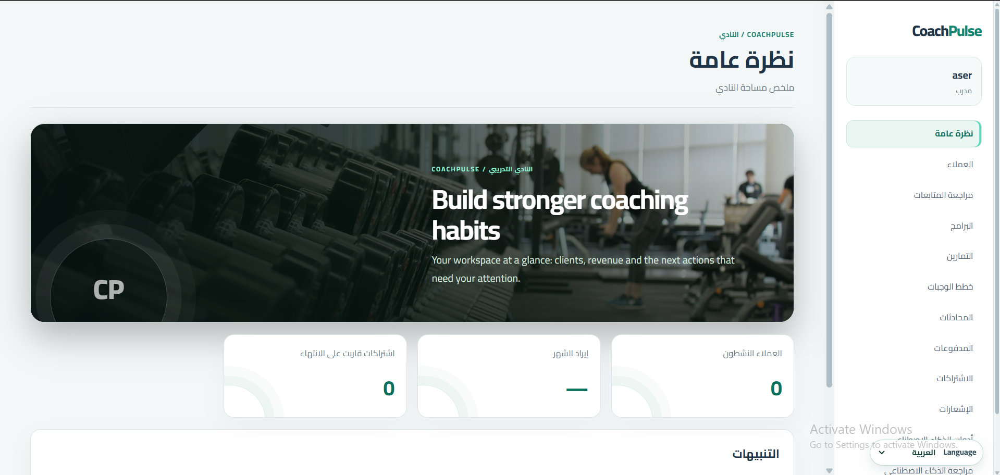
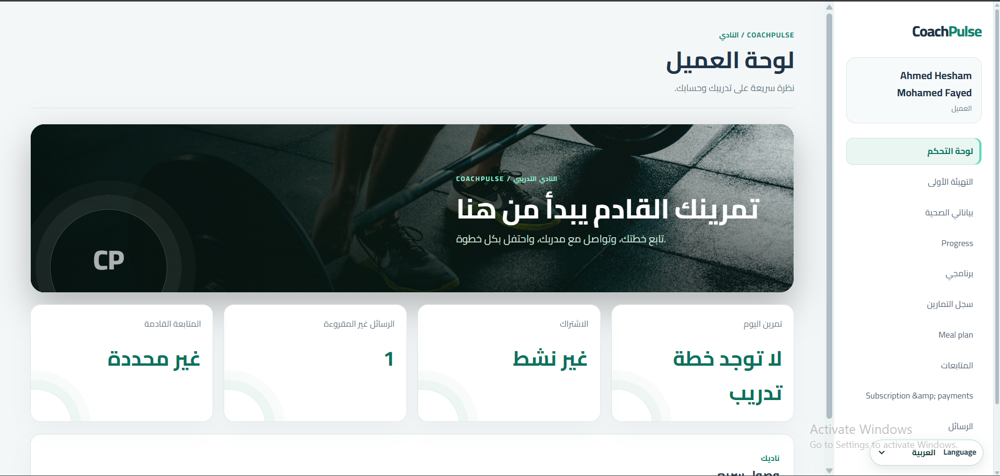
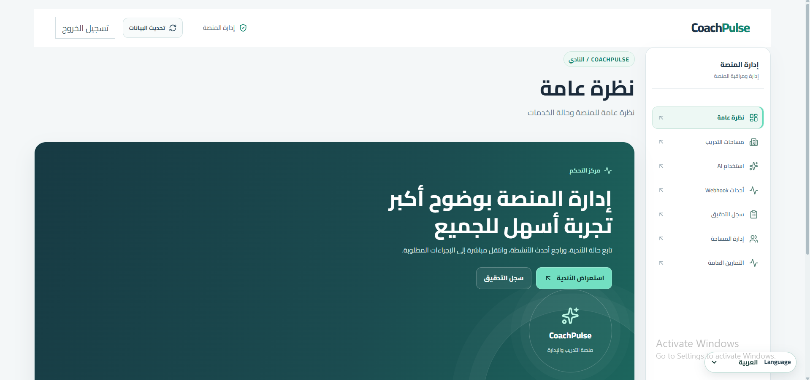
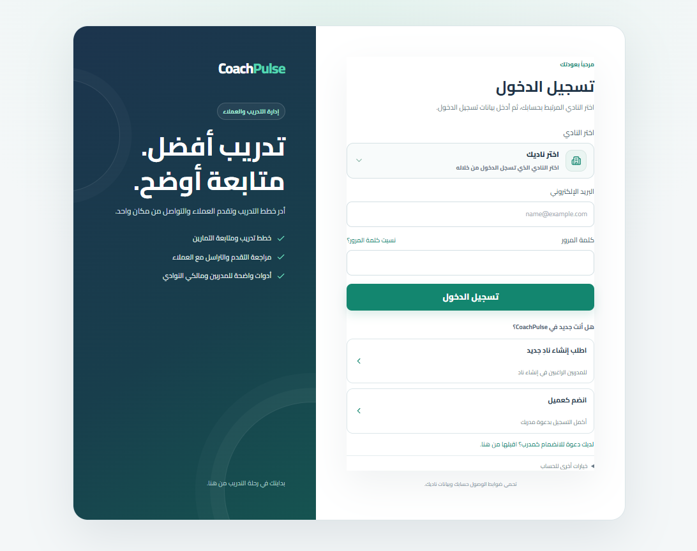
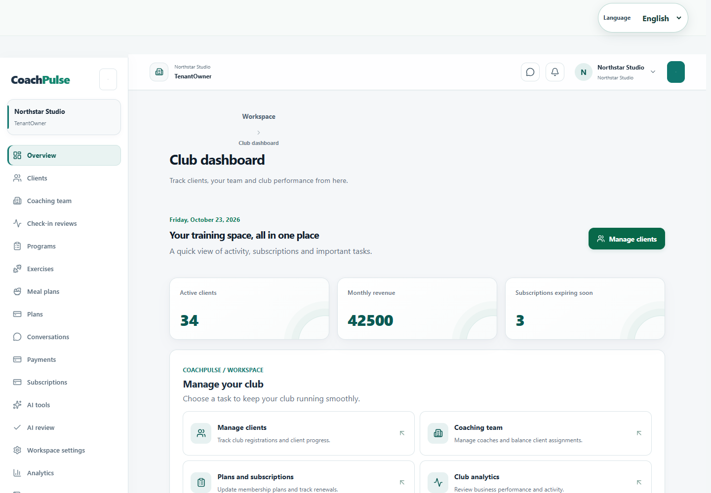
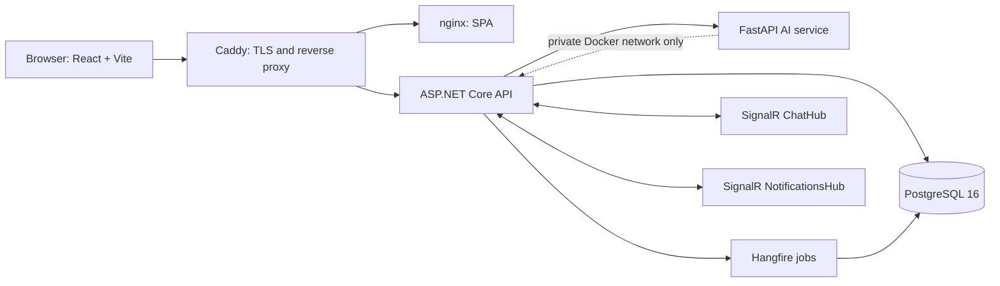

# CoachPulse

CoachPulse is a multi-tenant coaching platform for client onboarding, training and meal plans, subscriptions, payments, check-ins, messaging, notifications, and AI-assisted program drafts.


## Screenshots

| Coach workspace | Client workspace | SuperAdmin |
|---|---|---|
|  |  |  |

| Sign in | Tenant Owner workspace |
|---|---|
|  |  |

## Features by role

- **Client:** profile and onboarding, current program and meal plan, workout and check-in logs, subscription and payment history, invoices, chat, and notifications.
- **CoachStaff:** assigned clients, programs, check-in reviews, workouts/adherence, chat, AI drafts, and client subscriptions where authorized.
- **TenantOwner:** tenant settings, coach team, clients and invitations, plans, subscriptions, payments, analytics, audit history, AI usage, and branding.
- **SuperAdmin:** tenant lifecycle and aggregate usage, public exercise catalog, platform audit and webhook event review.

## Architecture



The browser uses the same origin for REST and SignalR. Caddy routes `/api/*`, `/hubs/*`, `/healthz`, `/readyz`, and `/hangfire*` to the API and all other paths to the SPA. PostgreSQL and the Python service are on an internal network. The API alone bridges that network to the public proxy network.

## Technology

- ASP.NET Core 9, Entity Framework Core, PostgreSQL 16, Hangfire, SignalR.
- React, TypeScript, Vite, React Router, TanStack Query, Playwright.
- FastAPI, Pydantic, scikit-learn Random Forest, pytest.
- Docker Compose, nginx, Caddy.

## Repository layout

| Path | Purpose |
|---|---|
| `CoachPulse.Api/` | HTTP API, hubs, authorization, readiness, hosted startup |
| `CoachPulse.Application/` | DTOs and application interfaces |
| `CoachPulse.Domain/` | Entities, roles, and domain enums |
| `CoachPulse.Infrastructure/` | EF Core, migrations, storage, payments, jobs, seeders |
| `CoachPulse.Api.Tests/` | .NET API and domain tests |
| `CoachPulse.Frontend/` | React/Vite app, generated API declarations, Playwright tests |
| `CoachPulse.AI/` | Internal FastAPI service, model training, pytest tests |
| `docs/` | OpenAPI, integration audit, runbooks, security and provider setup |

## Quick start with Docker Compose

1. Copy `.env.example` to `.env` and fill the required values. Generate `JWT_KEY` and `INTERNAL_API_KEY` independently with at least 32 random bytes. Set `SUPERADMIN_EMAIL` and a unique `SUPERADMIN_PASSWORD` (16+ characters with uppercase, lowercase, number, and symbol). `.env` is ignored by Git.
2. Start the development stack:

   ```powershell
   docker compose up --build -d
   ```

3. Open `http://localhost:8080` (the default `PROXY_HTTP_PORT`; choose another free host port in `.env` if it is occupied). The API migrator runs once before the API starts. Check the edge-routed readiness endpoint:

   ```powershell
   Invoke-RestMethod http://localhost:8080/readyz
   ```

4. Sign in with the `SUPERADMIN_EMAIL` and `SUPERADMIN_PASSWORD` values from your local `.env`; leave the tenant slug empty for SuperAdmin. On the first sign-in, the UI asks you to change the bootstrap password before opening the admin dashboard. Changing `.env` later does not change a SuperAdmin account that is already stored in the database.
5. A new workspace is a request, not an immediately active account. The owner receives no session at registration. A SuperAdmin reviews it under **Workspace requests** in the platform dashboard, enters an approval reason, and approves it. The owner can sign in after approval. Pending workspaces are hidden from public workspace lookup and cannot accept client registrations.

The standalone exercise catalog seed is optional and idempotent:

```powershell
docker compose --profile tools run --rm exercise-seed
```

Demo seed data is Development-only. To fill the demo tenant with clients, staff, plans, a pending subscription/payment, a program and exercises, a meal plan, check-ins, workout history, chat, and notifications, set `DemoSeed__Enabled=true` and provide `DemoSeed__Password` (at least 16 characters) through .NET user-secrets or the local process environment. The same password is used by the demo owner, staff, and clients. Demo accounts are `coach@coachpulse-demo.test`, `staff@coachpulse-demo.test`, and `client1@coachpulse-demo.test` through `client3@coachpulse-demo.test`; use workspace slug `coachpulse-demo`. Do not enable this seed in Production. The Compose stack does not enable demo seeding.

For production, provide a DNS name and contact email in `SITE_DOMAIN` and `ACME_EMAIL`, set `CORS_ALLOWED_ORIGIN` to the exact HTTPS origin, then run:

```powershell
docker compose -f docker-compose.yml -f docker-compose.prod.yml up --build -d
```

Only the Caddy proxy publishes ports 80/443 in production. PostgreSQL and AI have no host-published ports.

## Local development without Docker

Start a local PostgreSQL 16 service and create a development database. Store `ConnectionStrings:DefaultConnection`, `Jwt:Key`, `Jwt:Issuer`, and `Jwt:Audience` using .NET user-secrets. Apply migrations and run the API:

```powershell
dotnet user-secrets set "ConnectionStrings:DefaultConnection" "Host=localhost;Port=5432;Database=coachpulse;Username=coachpulse;Password=<local-only-password>" --project CoachPulse.Api
$bytes = New-Object byte[] 48
$rng = [Security.Cryptography.RandomNumberGenerator]::Create(); $rng.GetBytes($bytes)
dotnet user-secrets set "Jwt:Key" ([Convert]::ToBase64String($bytes)) --project CoachPulse.Api
dotnet user-secrets set "Jwt:Issuer" "CoachPulse.Api" --project CoachPulse.Api
dotnet user-secrets set "Jwt:Audience" "CoachPulse.Client" --project CoachPulse.Api
# Optional Development-only demo data; replace the placeholder locally.
dotnet user-secrets set "DemoSeed:Enabled" "true" --project CoachPulse.Api
dotnet user-secrets set "DemoSeed:Password" "<local-demo-password-16-characters-minimum>" --project CoachPulse.Api
dotnet ef database update --project CoachPulse.Infrastructure --startup-project CoachPulse.Api
dotnet run --project CoachPulse.Api --launch-profile http
```

The API listens at `http://localhost:5006`. Start the frontend in a second terminal:

```powershell
Set-Location CoachPulse.Frontend
Copy-Item .env.example .env.local
npm ci
npm run dev
```

Vite proxies `/api`, `/hubs` (WebSocket upgrades included), `/healthz`, and `/readyz` to port 5006. For local Python development, follow [CoachPulse.AI/README.md](CoachPulse.AI/README.md), use `LLM_PROVIDER=mock`, set an internal key in the API and AI environments, and point `Ai:BaseUrl`/`PythonAi:BaseUrl` to the local FastAPI port. Never place development credentials in tracked settings.

## Configuration reference

Examples below are placeholders only; no live credentials belong in this table or in Git.

| Variable | Purpose | Required | Example |
|---|---|---:|---|
| `POSTGRES_DB` | Database name | Yes | `CoachPulseDb` |
| `POSTGRES_USER` | Database role | Yes | `coachpulse` |
| `POSTGRES_PASSWORD` | Database password | Yes | `<generated secret>` |
| `JWT_KEY` | Access/refresh token signing | Yes | `<base64 of 48 random bytes>` |
| `INTERNAL_API_KEY` | API-to-AI authentication | Yes | `<32+ random bytes>` |
| `SUPERADMIN_EMAIL` | Initial platform administrator | Yes | `admin@example.invalid` |
| `SUPERADMIN_PASSWORD` | One-time bootstrap password | Yes | `<unique 16+ character secret>` |
| `CORS_ALLOWED_ORIGIN` | Exact browser origin; no wildcard | Yes | `https://coach.example.com` |
| `SITE_DOMAIN` | Caddy production hostname | Production | `coach.example.com` |
| `ACME_EMAIL` | Caddy ACME registration | Production | `ops@example.com` |
| `LLM_PROVIDER` | `mock` or `openai` | No | `mock` |
| `LLM_API_KEY` | OpenAI-compatible provider credential | Only for `openai` | `<provider secret>` |
| `PAYMOB_PUBLIC_KEY` | Unified Checkout public key | Only when enabled | `<Paymob public key>` |
| `PAYMOB_SECRET_KEY` | Server-side intention authorization | Only when enabled | `<Paymob secret>` |
| `PAYMOB_INTEGRATION_ID` | Paymob payment integration | Only when enabled | `<integration id>` |
| `PAYMOB_BASE_URL` | Paymob regional API host | No | `https://accept.paymob.com/` |
| `PAYMOB_RETURN_URL` | Browser return page | When Paymob enabled | `https://coach.example.com/my/payment/return` |
| `PAYMOB_NOTIFICATION_URL` | Paymob server webhook | When Paymob enabled | `https://coach.example.com/api/webhooks/paymob` |
| `PAYMOB_HMAC_SECRET` | Webhook authenticity check | When Paymob enabled | `<Paymob webhook secret>` |
| `EMAIL_PROVIDER` | `Dev` or `Smtp` | No | `Dev` |
| `EMAIL_SMTP_HOST` | SMTP hostname | Only for SMTP | `smtp.example.com` |
| `EMAIL_SMTP_PORT` | SMTP port | Only for SMTP | `587` |
| `EMAIL_SMTP_USE_SSL` | SMTP TLS mode | No | `true` |
| `EMAIL_SMTP_USERNAME` | SMTP account | Only for authenticated SMTP | `<mailbox>` |
| `EMAIL_SMTP_PASSWORD` | SMTP credential | Only for authenticated SMTP | `<mail secret>` |
| `EMAIL_SMTP_FROM_ADDRESS` | Sender address | For SMTP | `noreply@example.com` |
| `EMAIL_SMTP_FROM_NAME` | Sender display name | No | `CoachPulse` |

## Database and seed data

The production Compose API waits for the one-shot `migrator` service, which runs EF Core migrations. Local development uses `dotnet ef database update`. Runtime startup checks that migrations are current and seeds the environment-provided SuperAdmin. Seed the shared exercise library separately; demo data is restricted to Development.

## Checks and tests

```powershell
dotnet build CoachPulse.sln
dotnet test CoachPulse.sln
Set-Location CoachPulse.AI; python -m pytest
Set-Location ..\CoachPulse.Frontend
npm run typecheck
npm run lint
npm run build
npm run test:e2e
```

Latest local verification (2026-10-18): .NET build passed and 114 tests passed; frontend typecheck, lint, and build passed; Python pytest passed 6 tests; Playwright passed 2/2 against Compose, including the authenticated SignalR chat journey. The Compose stack was reachable at `http://127.0.0.1:8088` because port 8080 was occupied; `/healthz` and `/readyz` returned 200. These results cover the recorded flows, not every route or security edge case. See [INTEGRATION_NOTES.md](INTEGRATION_NOTES.md) for detail.

## Paymob

Use Sandbox credentials for development and configure the dashboard's return and notification URLs. The frontend redirects to hosted Unified Checkout and polls payment status; return-page query parameters are never proof of payment. A verified webhook is the source of truth. For local webhook delivery expose the API with ngrok or Cloudflare Tunnel and update both the dashboard and `PAYMOB_NOTIFICATION_URL`. See [docs/PAYMOB.md](docs/PAYMOB.md).

## AI and email

The internal FastAPI service is not published to the host. `LLM_PROVIDER=mock` uses a deterministic development fake and emits a warning; generated content is not a production model result. Set an approved provider and secret only in the runtime environment. The churn model artifact is trained from documented synthetic examples; its metrics are not production performance claims. Email defaults to development logging; SMTP is configured separately.

## Security and operations

- JWT, internal API, database, SuperAdmin, Paymob, LLM, and SMTP secrets come from environment variables or a secret store; rotate them without committing them.
- HTTPS terminates at Caddy in production; the API trusts forwarded headers only behind the compose proxy boundary. Security headers are set at the proxy and API.
- API, AI, and nginx run as non-root users. Files and Data Protection keys use persistent, private volumes outside the web root.
- Tenant authorization is enforced server-side. AI has no host-published port; database has no production host port.
- Back up PostgreSQL, uploads, and Data Protection keys together. Encrypt backups and test restoration before relying on them. See [docs/SECURITY.md](docs/SECURITY.md) and [docs/RUNBOOK.md](docs/RUNBOOK.md).

## Backup and restore

Create a database dump using the Compose database container; use the secret source for credentials rather than writing them to a command transcript:

```powershell
docker compose exec -T postgres sh -c 'pg_dump -U "$POSTGRES_USER" "$POSTGRES_DB"' > coachpulse-backup.sql
```

For restore, stop API writes, restore into the intended database, then restore the matching uploads and Data Protection volumes from encrypted backups before starting the application. See the runbook for operational checks.

## Troubleshooting

- **Compose says a variable is missing:** copy `.env.example` to `.env` and fill required values. `docker compose config -q` validates YAML and interpolation without displaying the resolved settings.
- **`/readyz` returns 503:** inspect database health, the `migrator` exit status, API startup logs, and AI `/ready` readiness. `/healthz` is liveness only.
- **Paymob webhook never arrives locally:** localhost is not public. Use a tunnel, make sure the notification URL is HTTPS and points to `/api/webhooks/paymob`, and check HMAC configuration.
- **Access denied after restoring a snapshot:** restore the matching Data Protection key volume along with the database; keys protect idempotency snapshots.
- **Hub is disconnected behind a proxy:** ensure `/hubs/*` is routed to the API with WebSocket upgrades and use the same public origin as the SPA.

## Roadmap

- Add automated host/public network probes for the private AI container; Compose currently publishes no AI port.
- Expand the passing multi-user Playwright journey into route-specific authorization, tenant-isolation, rate-limit, and failure-path tests.
- Maintain dependency scanning in CI and close the remaining security verification items in `SECURITY_REVIEW.md`.

## License

No license has been selected yet. All rights are reserved until a license file is added.
